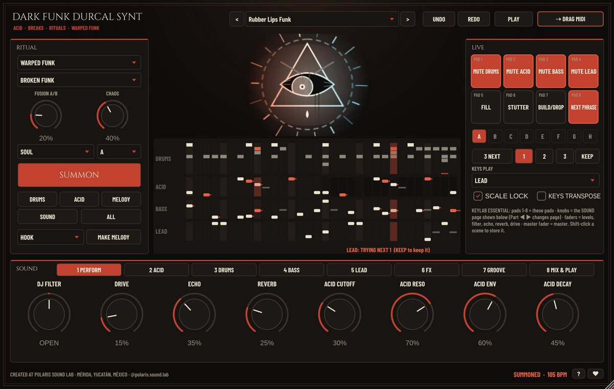
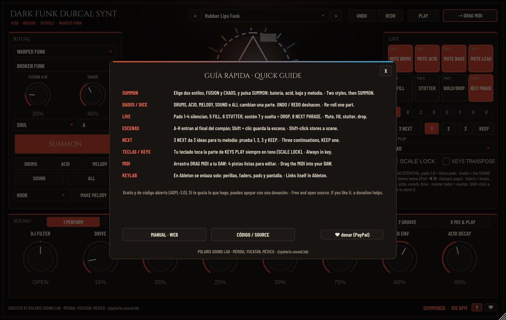

<p align="center"></p>

<h1 align="center">DARK FUNK DURCAL SYNT v2 · plugin</h1>
<p align="center"><b>Gratis y de código abierto · Free and open source (AGPL-3.0)</b><br>
AU · VST3 · Standalone — Mac (Apple Silicon + Intel) y Windows 10/11<br>
Acid · breaks · funk deformado · IDM — siempre en tono, para tocar en vivo</p>

<p align="center">
<a href="https://drophlex.github.io/dark-funk-durcal-synt-fm1/plugin.html"></a>
<a href="https://github.com/drophlex/dfd-synth-plugin/releases/latest"></a>
<a href="https://www.paypal.com/donate/?business=drophlex%40gmail.com&currency_code=MXN"></a>
</p>

## Instalar · Install

| | |
|---|---|
| **Mac** | Descarga `DarkFunkDurcalSynt-v2-macOS.zip` → clic derecho en **Install.command** › **Abrir**. |
| **Windows** | Descarga `DarkFunkDurcalSynt-v2-Windows.zip` → extrae → doble clic en **Install.bat** › **Sí**. |
| **Ableton + KeyLab Essential** | Conéctalo: Live enlaza el script `DFD_KeyLab_Essential` solo (pantalla, perillas, faders, pads, teclas, transporte). |
| **Otros DAW** | Logic, FL Studio, Bitwig, Reaper, Cubase, Studio One, GarageBand: búscalo como instrumento *Polaris Sound Lab*. |

Guía con imágenes: **https://drophlex.github.io/dark-funk-durcal-synt-fm1/plugin.html** · El botón **?** del plugin abre
la guía rápida.

<p align="center"></p>

## Compilar · Build

Necesitas CMake 3.22+ y un compilador C++17 (Xcode en Mac, Visual Studio en Windows). JUCE 8 se descarga solo.

```sh
cmake -S . -B build                      # Mac: -G Xcode -DCMAKE_OSX_ARCHITECTURES="arm64;x86_64"
cmake --build build --config Release     # -> build/DarkFunkDurcalSynt_artefacts/Release/{AU,VST3,Standalone}
cmake -S . -B build-test -DDFD_TESTS=ON && cmake --build build-test --target DfdHostTest   # the host test
```

- `Source/dsp` — el motor (sin JUCE): batería, acid tipo 303, bajo, lead, tape echo, reverb, stutter, generadores.
- `Source/` — el plugin JUCE y su editor. `ParamTable.h` = los 64 parámetros en el orden de los bancos del KeyLab.
- `KeyLab/DFD_KeyLab_Essential` — la control surface de Ableton Live (con auto-detección).
- `packaging/` — los instaladores (Install.command, Install.bat) y el LEEME.
- `.github/workflows/build.yml` — cada push compila Mac (universal, AU validado con `auval`) y Windows, y publica los zips
  en la release **v2**.

## Licencia · License

**GNU AGPL-3.0** (ver `LICENSE`, `LICENSE-NOTES.md`). Hecho con JUCE 8 (AGPLv3). Fuentes Cinzel y Barlow Condensed (OFL 1.1).

Si te gusta lo que hago, puedes apoyar con una donación por PayPal: **drophlex@gmail.com** ♥

**Creado en Polaris Sound Lab · Mérida, Yucatán, México** · [Instagram @polaris.sound.lab](https://www.instagram.com/polaris.sound.lab/) ·
[YouTube @PolarisSoundLab](https://www.youtube.com/@PolarisSoundLab) ·
*What is Dark Funk Durcal? Search it on Spotify, YouTube and every audio platform.*
